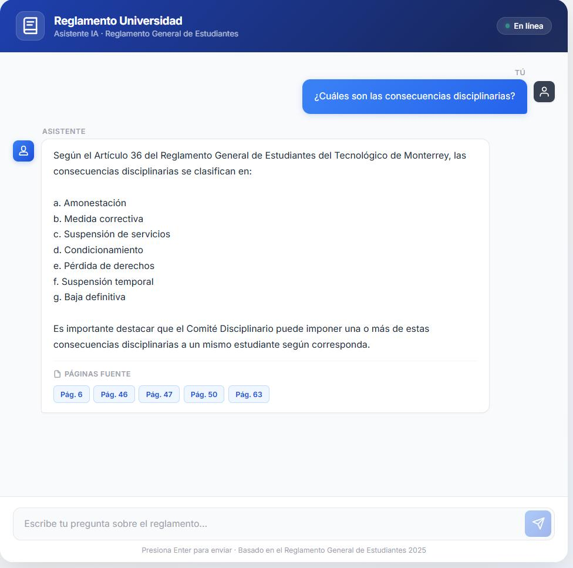

# RAG App — Reglamento Universitario

A production-ready full-stack Q&A application powered by a Retrieval-Augmented Generation (RAG) pipeline. Designed to query complex university documentation (**Reglamento General de Estudiantes**) with accurate citations, strict context attribution, and zero hallucination.

[](https://full-stack-rag-app-beta.vercel.app/)
[](https://full-stack-rag-app-rk4t.onrender.com/health)
[](https://www.linkedin.com/in/dylan-estrada-606691216/)

🌐 **Live Application:** [https://full-stack-rag-app-beta.vercel.app/](https://full-stack-rag-app-beta.vercel.app/)  
👨‍💻 **Author:** [Dylan Estrada](https://www.linkedin.com/in/dylan-estrada-606691216/)

---

## 📌 Project Highlights

- **Full-Stack Architecture**: End-to-end decoupled system featuring a **React (Vite)** single-page chat interface and a high-performance **FastAPI** backend, fully containerized with **Docker** and deployed across **Vercel** (CDN) and **Render** (Container).
- **Hybrid Retrieval System**: Combines semantic dense retrieval (MMR diversity + ChromaDB with `all-MiniLM-L6-v2` embeddings) with keyword sparse search (**BM25**), with cross-encoder reranking support for maximal answer relevance.
- **Automated Ingestion Pipeline**: End-to-end PDF processing with PyMuPDF, recursive/semantic chunking, embedding generation, and automated vectorstore caching.
- **Ultra-Fast Cloud Inference**: Powered by **Groq API** (`openai/gpt-oss-120b`) delivering high-quality, contextual answers with sub-second response times without expensive GPU infrastructure.
- **Empirical Optimization**: Retrieval hyperparameters (`k`, `lambda_mult`, dense/sparse weights) rigorously tuned across 20+ experimental configurations evaluated against custom ground-truth Q&A data using **Hit Rate** and **MRR** metrics.
- **User Experience & Safety**: Client-side & server-side character constraints (500 max chars), live input counter, error states, and responsive design.

---

## 🧠 RAG Pipeline Architecture

```
[ PDF Document ] ──► PyMuPDF Parsing ──► Recursive Chunking ──► all-MiniLM-L6-v2 Embeddings ──► ChromaDB
                                                                                                  │
[ User Query ] ──┬──► Dense Semantic Search (ChromaDB + MMR) ──────────┐                           │
                 │                                                     ├──► Hybrid Ensemble (60/40)
                 └──► Sparse Keyword Search (Rank-BM25) ───────────────┘            │
                                                                                    ▼
[ Groq LLM ] ◄── Prompt Contextualization ◄── Top Relevant Snippets ◄────── Cross-Encoder Sorting
      │
      ▼
[ Verified Answer + Source Page Numbers ]
```

1. **Indexing & Embedding**:
   - The official PDF is extracted using **PyMuPDF** preserving page metadata.
   - Text is split into structured chunks and embedded into 384-dimensional vectors using `all-MiniLM-L6-v2`.
   - Vectors are stored in a local **ChromaDB** collection for fast similarity search.
2. **Hybrid Search (Dense + Sparse)**:
   - When a user asks a question, the system queries both semantic meaning (**MMR**) and exact terms (**BM25**).
   - Results are blended (60% semantic / 40% lexical) to avoid missing specific article numbers while maintaining semantic breadth.
3. **Context-Constrained Generation**:
   - Top candidates are formatted as strict context within an instruction-tuned system prompt.
   - The **Groq LLM** generates the final response citing specific articles and chapters, explicitly refusing to answer if the context is insufficient.

---

## 🛠️ Tech Stack

| Layer | Technology | Purpose |
| :--- | :--- | :--- |
| **Frontend** | React 19, Vite, Vanilla CSS | Interactive chat UI with character limits, dynamic indicators, and mobile responsiveness |
| **Backend API** | FastAPI, Uvicorn, Pydantic | High-speed asynchronous REST API with validation and CORS control |
| **RAG Orchestration** | LangChain / LangChain-Classic | LCEL chain composition, retriever blending, and prompt templating |
| **Vector Database** | ChromaDB | Local vector persistence and similarity search |
| **Embeddings** | Sentence Transformers (`all-MiniLM-L6-v2`) | Dense vector generation on CPU |
| **Keyword Search** | Rank-BM25 | Sparse lexical retrieval |
| **Document Parsing** | PyMuPDF (fitz) | High-speed PDF text extraction with page metadata |
| **LLM Inference** | Groq Cloud API (`openai/gpt-oss-120b`) | Low-latency inference with free-tier accessibility |
| **Deployment** | Docker, Vercel, Render | Containerized backend on Render and global edge frontend on Vercel |

---

## 📊 Optimization & Evaluation

The retrieval configuration is the result of empirical hyperparameter tuning:

1. **Ground Truth Benchmark**: A curated evaluation dataset of Q&A pairs was mapped directly to verified source pages from the regulation PDF.
2. **Chunking Experiments**: Evaluated **20 different chunking strategies** varying chunk sizes, overlaps, and split strategies (recursive vs. semantic).
3. **Random Search Tuning**: Conducted a randomized search over **20 retrieval configurations** optimizing:
   - `k` (retrieved document count)
   - `lambda_mult` (diversity weighting for MMR)
   - Dense vs. Sparse hybrid balance weights
4. **Metrics**: Evaluated using **Hit Rate** (% of queries where correct document is in top-K) and **MRR** (Mean Reciprocal Rank).

The deployed settings represent the **highest-performing configuration** discovered during this evaluation phase.

---

## 🚀 Quick Start (Local Setup)

### Option A — Run with Docker (Recommended)

> **Requirements:** [Docker Desktop](https://www.docker.com/products/docker-desktop/) installed and running.

```bash
# 1. Clone the repository
git clone https://github.com/DylanEstrada9838/full-stack-rag-app.git
cd full-stack-rag-app

# 2. Configure environment
cp .env.example .env     # Linux/macOS
copy .env.example .env   # Windows
# Edit .env and insert your GROQ_API_KEY (from https://console.groq.com)

# 3. Start the application
docker compose up --build
```

Access the services:
* 🌐 **Frontend UI:** `http://localhost:3000`
* ⚙️ **Backend API:** `http://localhost:8000` (Health: `http://localhost:8000/health`)

---

### Option B — Manual Setup (Development)

#### 1. Backend

```bash
cd backend

# Create virtual environment
python -m venv venv
venv\Scripts\activate        # Windows
# source venv/bin/activate   # macOS/Linux

# Install dependencies
pip install -r requirements.txt

# Configure environment
cp .env.example .env         # Add your GROQ_API_KEY in .env

# Build vector database (first time only)
python rebuild_db.py

# Run API server
uvicorn main:app --reload
```

#### 2. Frontend

```bash
cd frontend

# Install dependencies
npm install

# Start development server
npm run dev
```

Frontend will run at `http://localhost:5173`.

---

## 📁 Repository Structure

```
rag-app/
├── assets/                  # Media and interface screenshots
├── backend/                 # FastAPI backend service
│   ├── rag_pipeline/        # Chunking, vectorstore, hybrid retriever, LLM chain
│   │   ├── documents/       # Source PDF documents
│   │   └── chroma_db/       # Local vector store (auto-generated)
│   ├── Dockerfile           # Optimized container image (CPU-only PyTorch)
│   ├── main.py              # FastAPI server entry point
│   ├── config.py            # Environment & CORS configuration
│   ├── rebuild_db.py        # Vector database build script
│   └── requirements.txt     # Python dependencies
├── frontend/                # React (Vite) client application
│   ├── src/                 # Chat components, state, and styles
│   ├── Dockerfile           # Nginx container image for production
│   └── package.json         # Node.js dependencies & scripts
├── docker-compose.yml       # Docker multi-service orchestration
├── .env.example             # Environment template
└── README.md
```

---

## 📡 API Endpoints

| Method | Endpoint | Description |
| :--- | :--- | :--- |
| `GET` | `/health` | Health check & pipeline readiness status |
| `POST` | `/ask` | Submit question (3–500 chars), returns answer + page citations |

### Example Request

```bash
curl -X POST https://full-stack-rag-app-rk4t.onrender.com/ask \
  -H "Content-Type: application/json" \
  -d '{"question": "¿Qué implica la baja definitiva?"}'
```

### Example Response

```json
{
  "answer": "La baja definitiva implica la pérdida total de la condición de estudiante del Tecnológico de Monterrey...",
  "sources": [47, 51]
}
```

---

### 📸 Application UI


---

## 👨‍💻 Author

**Dylan Estrada**
* 💼 LinkedIn: [dylan-estrada](https://www.linkedin.com/in/dylan-estrada-606691216/)
* 🐙 GitHub: [@DylanEstrada9838](https://github.com/DylanEstrada9838)
