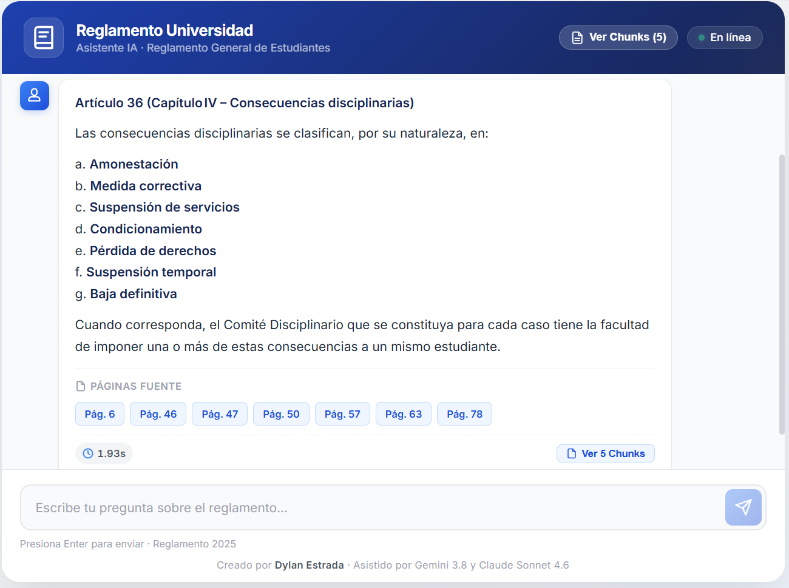
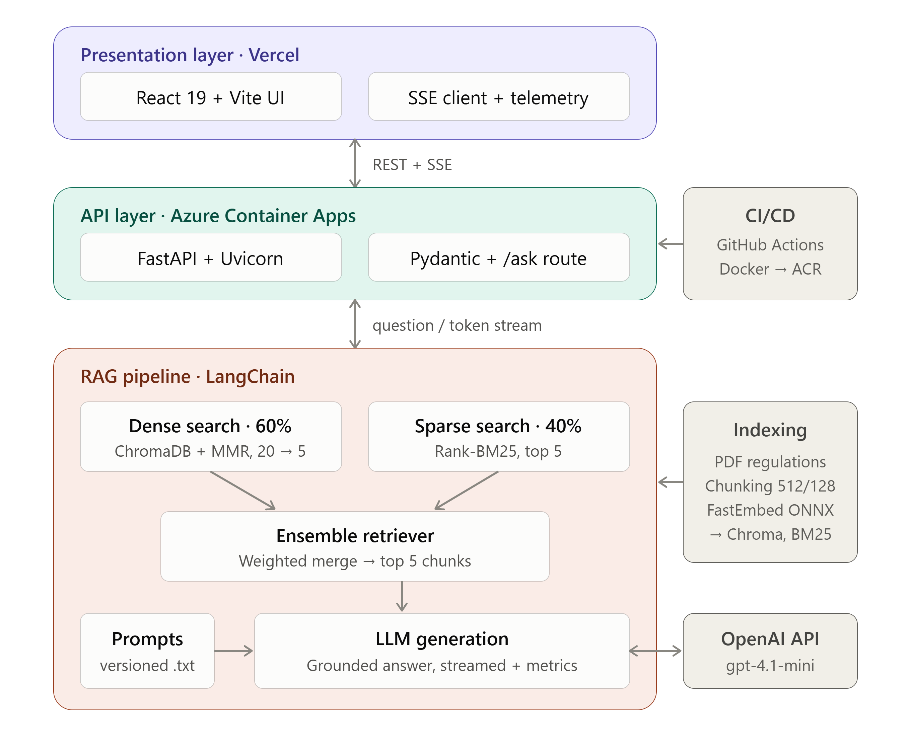

# Full-Stack RAG Application

A full-stack Retrieval-Augmented Generation (RAG) application
that enables users to interact with institutional documents
through a conversational AI interface.

The application combines semantic and keyword-based retrieval,
hybrid search, reranking, and LLM-powered generation to provide
relevant, context-grounded answers.

Built with React, FastAPI, LangChain, ChromaDB, and OpenAI.

[](https://full-stack-rag-app-beta.vercel.app/)
[](https://fastapi.tiangolo.com/)

🌐 **Live Application:** [https://full-stack-rag-app-beta.vercel.app/](https://full-stack-rag-app-beta.vercel.app/)

---

## 📸 UI Preview



---

## ✨ Key Features

- Conversational AI interface for querying institutional documents.
- Hybrid retrieval combining dense semantic search and sparse BM25.
- Maximal Marginal Relevance (MMR) for diverse document retrieval.
- Context-grounded generation using OpenAI Responses API.
- Real-time response streaming using Server-Sent Events (SSE).
- Retrieval and generation telemetry, including latency and token usage.
- Docker-based containerization and automated CI/CD.
- Cloud deployment using Azure Container Apps and Vercel.

## 🧠 RAG & Pipeline Architecture

The core of this AI project is an end-to-end, sub-second hybrid RAG pipeline engineered for high precision, low latency, and factual grounding against academic regulatory documents. The diagram below illustrates the high-level architecture and interactions between the presentation layer, API layer, RAG retrieval engine, and cloud services:



### 1. Orchestration Framework
* **LangChain**: Orchestrates the document loading, splitting, vectorstore indexing, ensemble retrieval (`EnsembleRetriever`), and prompt pipelines.

---

### 2. Chunking Strategy
* **Splitter**: `RecursiveCharacterTextSplitter`
* **Chunk Size**: `512` characters
* **Chunk Overlap**: `128` characters
* **Design Rationale**: A 512-character window preserves atomic legal and regulatory articles without diluting semantic meaning. The 128-character overlap guarantees that legal qualifications, exceptions, and procedural clauses spanning chunk boundaries maintain contiguous context.

---

### 3. Embedding Model
* **Model**: `sentence-transformers/all-MiniLM-L6-v2`
* **Inference Engine**: **FastEmbed ONNX Runtime** (CPU-optimized)
* **Optimization Benchmarks & Production Benefits**:
  * **Embedding Generation Time**: ~2–4x faster than standard PyTorch-based sentence transformers on CPU.
  * **Memory Consumption (RAM)**: Operates within low-memory cloud footprints without loading heavy PyTorch runtimes into memory.
  * **Docker Image Size**: Reduced by over 1.5 GB by omitting CUDA/PyTorch dependencies.
  * **API Response Latency**: Sub-millisecond vector encoding per incoming user query.

---

### 4. Hybrid Retrieval Engine
Combines semantic understanding (dense vectors) with exact legal terminology matching (sparse lexical search):

* **Vector Database**: **ChromaDB** (persistent on disk with cosine distance).
* **Dense Vector Search (60% weight)**:
  * **Maximal Marginal Relevance (MMR)**: Balances two competing objectives:
    1. *Relevance*: Retrieves documents most semantically similar to the user's question.
    2. *Diversity*: Penalizes redundant chunks to ensure varied, non-repetitive legal contexts.
  * *Parameters*: Initially retrieves `fetch_k = 20` candidates and filters down to the `5` most diverse, useful chunks.
* **Sparse Lexical Search (40% weight)**:
  * **Rank-BM25**: Keyword-frequency matching optimized for exact article numbers, penalties, infractions, and specialized academic terms.
  * Pre-cached via serialized binary index (`bm25_retriever.pkl`) for zero cold-start delay.
  * Retrieves `5` keyword-matched candidates.
* **Reciprocal Rank Fusion / Ensemble**: Merges results with 0.6 dense / 0.4 sparse weighting, delivering the top 5 ground-truth chunks to the LLM in ~0.03s–0.06s.

---

### 5. LLM Model & Generation Layer
* **Model**: OpenAI `gpt-4.1-mini` via the official OpenAI Responses API.
* **Context & Prompt Grounding**: Context injected directly into system instructions, enforcing strict adherence to provided articles and mitigating hallucinations.
* **Prompt Versioning**: Systematic prompt templates managed in `backend/rag_pipeline/prompts/` (e.g. `v1.txt`, `v2.txt`), enabling zero-downtime prompt iterations via the `RAG_PROMPT_FILE` environment variable.
* **Real-Time Token Streaming**:
  * **Server-Sent Events (SSE)**: Streams text deltas in real-time (`response.output_text.delta`), displaying a progressive typewriter effect in the frontend as tokens are generated.
* **Full Telemetry & Metrics**:
  * **Time to First Token (TTFT)**: Measured and exposed in the telemetry payload.
  * **Dual Latencies**: Retrieval time vs. Model generation time tracked independently to 2 decimal places.
  * **Input & Output Tokens**: Exact token counts (including cached input token recognition).
  * **Cost Estimation**: Dynamic per-query cost calculation based on actual token usage ($0.40/1M uncached input, $0.10/1M cached input, $1.60/1M output).

---

### 6. API Layer
* **FastAPI**: Asynchronous Python web framework with auto-generated OpenAPI documentation.
* **Pydantic**: Robust data validation and schema enforcement for requests (`QuestionRequest`) and responses (`AnswerResponse`).
* **Uvicorn**: High-performance ASGI server.
* **Protocol**: Dual-mode HTTP REST API supporting both standard JSON requests and Server-Sent Events (`text/event-stream`).
* **Cloud Runtime**: Containerized and hosted on **Azure Container Apps** (Spain Central).

---

### 7. Presentation Layer
* **React 19 & Vite**: Ultra-fast, lightweight client-side application.
* **Responsive Design**: Custom Vanilla CSS with mobile-first layout, glassmorphism, blinking streaming cursor, and slide-out bottom sheet chunk inspector.
* **Live Telemetry UI**: Direct visual badges for Retrieval & Model durations, with a hoverable `+ Info` popover detailing TTFT, token usage, and query cost.
* **Hosting**: Deployed globally via **Vercel Edge Network**.

---

### 8. DevOps & CI/CD
* **Docker Containerization**: Production multi-layer Docker image with pre-warmed vectorstore and pre-cached BM25 index generated during build time.
* **GitHub Actions Workflow**: Automated CI/CD pipeline triggered on pushes to `main`.
* **Container Registry**: Automated image build and push to **Azure Container Registry (ACR)**.
* **Cloud Infrastructure**: Scalable container execution on **Azure Container Apps** with environment secret management.

---

## 🛠️ Tech Stack

| Category | Technologies | Purpose |
| :--- | :--- | :--- |
| **Orchestration & RAG** | LangChain, Rank-BM25 | Document loading, chunking, ensemble retrieval |
| **Embeddings & Vectorstore** | FastEmbed ONNX, ChromaDB | CPU-optimized dense embeddings & vector storage |
| **LLM & Inference** | OpenAI `gpt-4.1-mini`, SSE | Context-grounded generation & token streaming |
| **Backend API** | FastAPI, Uvicorn, Pydantic | High-concurrency async REST & streaming service |
| **Frontend UI** | React 19, Vite, Vanilla CSS | Responsive chat interface with real-time telemetry |
| **DevOps & Cloud** | Docker, GitHub Actions, Azure Container Apps, ACR, Vercel | Automated CI/CD, container registry & edge delivery |

---

## 🚀 Getting Started (Running Locally)

You can run the application locally using either **Docker Compose** (recommended for an isolated setup) or by running the **Backend & Frontend natively**.

### 1. Prerequisites

* [Git](https://git-scm.com/)
* [OpenAI API Key](https://platform.openai.com/api-keys)
* **For Docker Compose**: [Docker Desktop](https://www.docker.com/) (version 20.10+) & Docker Compose
* **For Native Execution**:
  * [Python 3.11+](https://www.python.org/)
  * [Node.js 18+](https://nodejs.org/) & `npm`

---

### 2. Environment Variables

Create your environment configuration by copying the example template:

```bash
# Root environment (used by Docker Compose)
cp .env.example .env

# Or for native backend development
cp backend/.env.example backend/.env
```

| Variable | Required | Default | Description |
| :--- | :--- | :--- | :--- |
| `OPENAI_API_KEY` | **Yes** | — | OpenAI API key for `gpt-4.1-mini` inference |
| `OPENAI_MODEL` | No | `gpt-4.1-mini` | OpenAI model identifier |
| `OPENAI_BASE_URL` | No | — | Custom endpoint (e.g. for Azure OpenAI) |
| `RAG_PROMPT_FILE` | No | `v2.txt` | Prompt template from `rag_pipeline/prompts/` |
| `HF_TOKEN` | No | — | HuggingFace Hub token (optional) |
| `EXTRA_CORS_ORIGINS`| No | — | Comma-separated list of allowed origins |

---

### 3. Option A: Run with Docker Compose (Recommended)

Build and launch both the backend API and frontend reverse-proxy containers in one command:

```bash
# 1. Clone repository
git clone https://github.com/DylanEstrada9838/full-stack-rag-app.git
cd full-stack-rag-app

# 2. Configure environment (set your OPENAI_API_KEY in .env)
cp .env.example .env

# 3. Build and launch services
docker compose up --build
```

* **Frontend UI**: [http://localhost:3000](http://localhost:3000)
* **Backend API**: [http://localhost:8000](http://localhost:8000)
* **Interactive Swagger Docs**: [http://localhost:8000/docs](http://localhost:8000/docs)

---

### 4. Option B: Native Execution

#### Step 1 — Backend (FastAPI)
```bash
cd backend

# Create and activate virtual environment
python -m venv venv
# On Windows:
venv\Scripts\activate
# On Linux/macOS:
source venv/bin/activate

# Install dependencies
pip install -r requirements.txt

# Configure environment variables in backend/.env
cp .env.example .env

# Build ChromaDB vectorstore and BM25 cache (first time only)
python rebuild_db.py

# Start development server
uvicorn main:app --reload --port 8000
```

#### Step 2 — Frontend (React + Vite)
In a separate terminal:
```bash
cd frontend

# Install packages
npm install

# Run Vite dev server
npm run dev
```

* The client will be available at [http://localhost:5173](http://localhost:5173) and connects directly to `http://localhost:8000`.

---

## 📁 Repository Structure

```text
rag-app/
├── .github/
│   └── workflows/
│       └── deploy-backend-azure.yml # CI/CD deployment to Azure Container Apps
├── backend/                         # FastAPI backend service
│   ├── rag_pipeline/                # RAG core modules
│   │   ├── documents/               # Source PDF regulation documents
│   │   ├── prompts/                 # Prompt versioning (v1.txt, v2.txt)
│   │   ├── chroma_db/               # Persistent Chroma vectorstore
│   │   ├── bm25_retriever.pkl       # Pre-cached BM25 index
│   │   ├── chunking.py              # Recursive character splitting logic
│   │   ├── vectorstore.py           # FastEmbed + ChromaDB setup
│   │   ├── retriever.py             # Hybrid ensemble (Dense MMR + Sparse BM25)
│   │   └── llm.py                   # OpenAI Responses API & SSE streaming
│   ├── Dockerfile                   # Production Dockerfile
│   ├── main.py                      # FastAPI server entry point
│   ├── routes.py                    # REST & SSE streaming endpoints (/ask)
│   ├── models.py                    # Pydantic request/response schemas
│   ├── rebuild_db.py                # Offline vectorstore & BM25 builder
│   └── requirements.txt             # Python dependencies
├── frontend/                        # React (Vite) client application
│   ├── src/
│   │   ├── components/              # ChatMessage, Header, ChunksPanel, WelcomeCard
│   │   ├── constants/               # Suggested regulatory questions
│   │   ├── App.jsx                  # State orchestrator & SSE consumer
│   │   └── App.css                  # Modern UI styles, telemetry popovers & animations
│   └── package.json                 # Node.js dependencies
├── docker-compose.yml               # Multi-container orchestration (backend + frontend)
└── README.md
```

---

## 👨‍💻 Author

**Dylan Estrada** · *Asistido por Gemini 3.8 y Claude Sonnet 4.6*  
💼 [LinkedIn](https://www.linkedin.com/in/dylan-estrada-606691216/) · 🐙 [GitHub](https://github.com/DylanEstrada9838)
